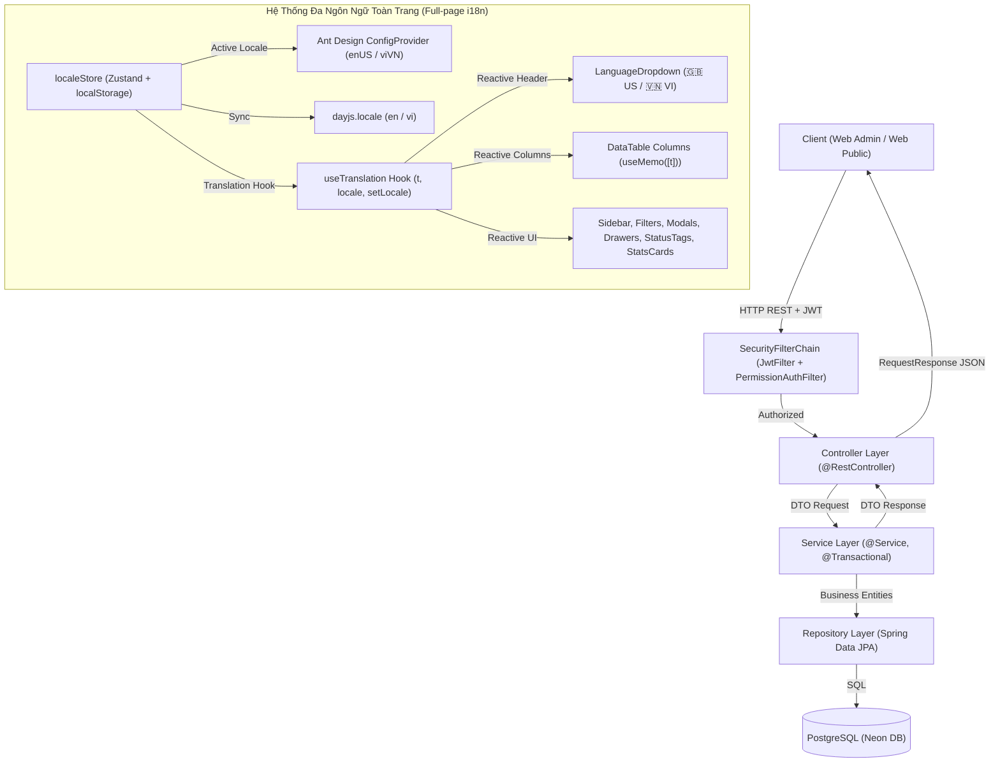

# Luồng Kiến Trúc Code Tổng Thể

## 1. Sơ đồ Mermaid luồng kiến trúc (Architecture Flow)

## 2. Các thành phần chính
* **Entry Points**: 
  * Lead Controller: [`LeadController`](file:///home/lenovo/Downloads/DATN/ecms_web_application/OC01/src/main/java/com/ecms_web_application/OC01/controller/LeadController.java)
  * Student Controller: [`StudentController`](file:///home/lenovo/Downloads/DATN/ecms_web_application/OC01/src/main/java/com/ecms_web_application/OC01/controller/StudentController.java) (bao gồm CRUD, chuyển đổi Lead, đổi status và API khóa/mở khóa tài khoản `PATCH /api/students/{id}/lock-account`)
  * RBAC Controller: [`RBACController`](file:///home/lenovo/Downloads/DATN/ecms_web_application/OC01/src/main/java/com/ecms_web_application/OC01/controller/RBACController.java) (quản lý phân quyền và khóa tài khoản `PATCH /api/rbac/accounts/{id}/lock`)
* **Xử lý nghiệp vụ**:
  * Lead Service: [`LeadService`](file:///home/lenovo/Downloads/DATN/ecms_web_application/OC01/src/main/java/com/ecms_web_application/OC01/service/LeadService.java)
  * Student Service: [`StudentService`](file:///home/lenovo/Downloads/DATN/ecms_web_application/OC01/src/main/java/com/ecms_web_application/OC01/service/StudentService.java)
  * Account Service: [`AccountRoleService`](file:///home/lenovo/Downloads/DATN/ecms_web_application/OC01/src/main/java/com/ecms_web_application/OC01/service/AccountRoleService.java)
* **Đa ngôn ngữ & Bản địa hóa toàn trang (Full-page i18n)**:
  * Dropdown chọn ngôn ngữ (Header): [`LanguageDropdown.tsx`](file:///home/lenovo/Downloads/DATN/ecms_web_application/ecms_web_admin/src/components/layout/LanguageDropdown.tsx) với UI chuẩn theo thiết kế Figma (cờ SVG chuẩn 🇬🇧 UK & 🇻🇳 VN, blue highlight item đang chọn).
  * State & Dictionaries: [`localeStore.ts`](file:///home/lenovo/Downloads/DATN/ecms_web_application/ecms_web_admin/src/stores/localeStore.ts), [`vi.ts`](file:///home/lenovo/Downloads/DATN/ecms_web_application/ecms_web_admin/src/locales/vi.ts), [`en.ts`](file:///home/lenovo/Downloads/DATN/ecms_web_application/ecms_web_admin/src/locales/en.ts), [`useTranslation.ts`](file:///home/lenovo/Downloads/DATN/ecms_web_application/ecms_web_admin/src/hooks/useTranslation.ts).
  * Đồng bộ toàn diện: Toàn bộ thành phần UI (Ant Design ConfigProvider + dayjs + Sidebar menu + Header + DataTable columns qua useMemo([t]) + Filters + Modals + Drawers + KPI metric cards + StatusTag) phản ứng tức thì không cần reload trang.
* **Hệ Thống Thiết Kế UI SaaS Hiện Đại (Modern SaaS UI/UX Design System)**:
  * Global Design Tokens ([`index.css`](file:///home/lenovo/Downloads/DATN/ecms_web_application/ecms_web_admin/src/index.css)): `.stat-card-modern` (hover elevation -3px, active indicator top border), `.btn-primary-gradient` (`#1677ff` -> `#0958d9` with glow), `.btn-success-gradient` (`#10b981` -> `#059669`), `.modern-table` (sticky subtle `#f8fafc` header, light borders, smooth row hover), `.action-btn-circle` với hover theme chuyên biệt (`.view`, `.edit`, `.assign`, `.interact`, `.test`, `.delete`), `.pulse-dot-amber` (breathing pulse indicator).
  * UserAvatar cá nhân hóa ([`UserAvatar.tsx`](file:///home/lenovo/Downloads/DATN/ecms_web_application/ecms_web_admin/src/components/common/UserAvatar.tsx)): Deterministic 7-color pastel palette dựa theo mã băm tên người dùng.
  * Form & Filter tiêu chuẩn: Form inputs, Select boxes, and SearchInput đồng bộ chuẩn chiều cao `38px` và `borderRadius: 8px`.
  * Modals & Drawers: Tiêu đề modal tích hợp container icon màu chủ đề (36x36px rounded-8), các thẻ chi tiết drawer có viền `#f1f5f9` và shadow nhẹ mịn màng.

## 3. Ghi chú quy chuẩn bắt buộc
### Bất biến (Invariants)
* Mọi request ghi (POST/PUT/DELETE) vào Lead và Student đều phải chạy trong `@Transactional`.
* Các bản ghi log (`LeadStatusLog`, `LeadAssignmentLog`, `StudentStatusLog`) chỉ thêm (append-only), không cho phép sửa hoặc xóa.
* Mã học viên `student_code` không được phép chỉnh sửa sau khi đã cấp.
* Khi đổi ngôn ngữ, trạng thái ngôn ngữ được duy trì bất biến qua các lần tải lại trang nhờ `localStorage`.
* Bảng dữ liệu Ant Design bắt buộc phải bọc `columns` bằng `useMemo(() => [...], [t])` để đảm bảo tiêu đề và thẻ trạng thái render lại tức thì khi chuyển ngôn ngữ.
* Mọi input, button, select và card phải tuân thủ chuẩn visual SaaS: `borderRadius` 8px-14px, chiều cao điều khiển chuẩn 38px, nút hành động dạng tròn 32px với tooltip rõ ràng.

### Giả định (Assumptions)
* User đã được xác thực qua token JWT khi gọi các API quản trị nội bộ.
* Database PostgreSQL đã có sẵn cấu trúc bảng và các ràng buộc khóa ngoại (foreign keys).

### Tác dụng phụ (Side-effects)
* Ghi dữ liệu trực tiếp vào database PostgreSQL.
* Tự động sinh nhật ký thay đổi trạng thái hoặc chuyển phân công khi thực hiện tác vụ tương ứng.
* Thay đổi ngôn ngữ cập nhật `localStorage` ('app_locale') và `dayjs.locale`.

### Luồng lỗi (Failure/Edge cases)
* Lỗi trùng lặp dữ liệu duy nhất (`student_code`, `lead_id`): Quăng `ErrorHandler(HttpStatus.CONFLICT)`.
* Không tìm thấy đối tượng (ID không tồn tại): Quăng `ErrorHandler(HttpStatus.NOT_FOUND)`.
* Dữ liệu request không hợp lệ: Bị chặn tại Bean Validation (`@Valid`) quăng `MethodArgumentNotValidException` (400 Bad Request).
