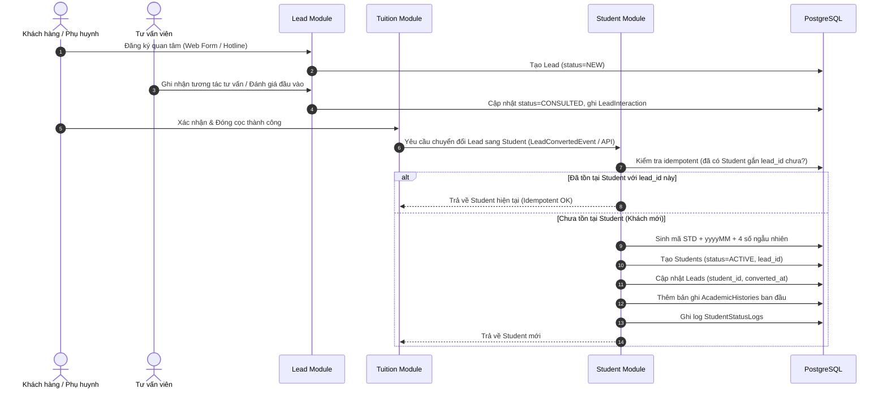

# Luồng Nghiệp Vụ Liên Module (Lead -> Student)

## 1. Sơ đồ Mermaid luồng chuyển đổi (Lead to Student Flow)

## 2. Ghi chú quy chuẩn bắt buộc
### Bất biến (Invariants)
* Mỗi `Lead` chỉ được chuyển đổi thành tối đa **1** `Student` (ràng buộc duy nhất `uk_students_lead`).
* Xử lý chuyển đổi phải đảm bảo tính `Idempotent`: Gọi nhiều lần cùng một yêu cầu chuyển đổi không được sinh trùng học viên.
* `Lead.status` không được lùi từ `CONSULTED` về `NEW`.

### Giả định (Assumptions)
* Khi chuyển đổi thành công, thông tin họ tên, email, số điện thoại được kế thừa từ `Lead` sang `Student`.
* Khách hàng thanh toán cọc thành công trước khi hệ thống thực hiện chuyển đổi thành `Student`.

### Tác dụng phụ (Side-effects)
* `Lead` được gán `student_id` và cập nhật mốc thời gian `converted_at`.
* Tự động tạo bản ghi `AcademicHistory` ban đầu nếu có `course_id`.
* Ghi nhận dòng nhật ký `StudentStatusLog` ghi rõ nguồn gốc tạo từ Lead.

### Luồng lỗi (Failure/Edge cases)
* Trùng mã học viên ngẫu nhiên: Thực hiện cơ chế retry sinh mã tối đa 10 lần trước khi báo lỗi.
* Lead không tồn tại trong hệ thống: Trả về lỗi `404 Not Found`.

