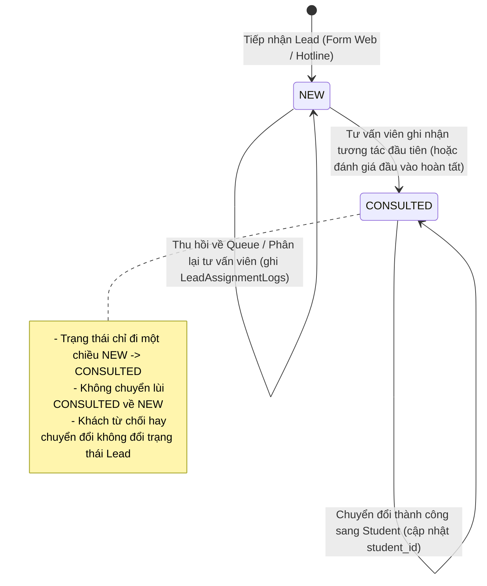

# Luồng Nghiệp Vụ Module Lead

## 1. Sơ đồ Mermaid trạng thái và thao tác Lead

## 2. Các hành động bắt buộc
1. **Tiếp nhận & Chuẩn hóa**:
   - Họ tên người học, email (chữ thường, trim), số điện thoại (+84 hoặc 0xxx).
   - Khởi tạo trạng thái `status = NEW`, `assigned_consultant_id` (nếu chưa gán thì ở Queue = null).
2. **Phân bổ tư vấn viên**:
   - Khi gán hoặc đổi `assigned_consultant_id`, bắt buộc ghi một bản ghi vào `lead_assignment_logs`.
3. **Ghi tương tác (Interaction)**:
   - Lưu vào `lead_interactions`: `interaction_type`, `notes`, `result`, `reject_reason` (bắt buộc khi `result = REJECTED`), `performed_by`.
   - Nếu Lead đang ở trạng thái `NEW`, tự động chuyển sang `CONSULTED` và ghi một bản ghi vào `lead_status_logs`.
4. **Đánh giá đầu vào (Placement Test)**:
   - Lưu vào `lead_placement_tests`: `test_status` (SCHEDULED, COMPLETED, REFUSED, NOT_ATTENDED), `scheduled_at`, `test_score`, `recommended_level`.
   - Ràng buộc: `test_score` chỉ được phép có khi `test_status = COMPLETED`.
5. **Giao diện quản trị & Trải nghiệm người dùng (UI/UX)**:
   - Thẻ thống kê KPI động (Tổng Lead, Chưa tư vấn, Hàng đợi TVV, Đã tư vấn) hỗ trợ lọc nhanh theo trạng thái.
   - Bảng hiển thị thông tin kèm Avatar, liên hệ (SĐT, Email), mã khóa học quan tâm, badge trạng thái bo tròn mềm mại và chuyển đổi thành học viên một chạm.
   - Drawer chi tiết dạng thẻ tab: Tổng quan, Lịch sử tương tác timeline, Đánh giá đầu vào và Nhật ký kiểm toán.

## 3. Ghi chú quy chuẩn bắt buộc
### Bất biến (Invariants)
* `Lead.status` chỉ chuyển một chiều từ `NEW` sang `CONSULTED`. Nghiêm cấm mọi hành vi đổi từ `CONSULTED` về `NEW`.
* `reject_reason` là bắt buộc khi kết quả tư vấn (`result`) là `REJECTED`.
* Điểm số đánh giá (`test_score`) chỉ hợp lệ khi `test_status == COMPLETED`.
* Mọi thay đổi trạng thái đều phải ghi vào `lead_status_logs`.
* Mọi lần đổi người phụ trách đều phải ghi vào `lead_assignment_logs`.

### Giả định (Assumptions)
* Người phụ trách (`assigned_consultant_id`) phải là tài khoản hợp lệ có vai trò tư vấn trong hệ thống.
* Nguồn Lead (`source_id`) tham chiếu tới danh mục `lead_sources` hợp lệ.

### Tác dụng phụ (Side-effects)
* Ghi dữ liệu vào `leads`, `lead_interactions`, `lead_placement_tests`, `lead_status_logs`, `lead_assignment_logs`.
* Tự động chuyển trạng thái `status` từ `NEW` sang `CONSULTED` khi ghi nhận tương tác đầu tiên.

### Luồng lỗi (Failure/Edge cases)
* Đổi trạng thái từ `CONSULTED` về `NEW`: Bị chặn bởi kiểm tra logic nghiệp vụ, trả về `400 Bad Request`.
* Ghi kết quả từ chối nhưng thiếu lý do từ chối: Bị chặn, trả về `400 Bad Request`.
* Nhập điểm khi trạng thái test là `REFUSED` hoặc `NOT_ATTENDED`: Bị chặn, trả về `400 Bad Request`.

