# Luồng Nghiệp Vụ Module Student

## 1. Sơ đồ Mermaid trạng thái và luồng học viên

```mermaid
stateDiagram-v2
    [*] --> ACTIVE: Chuyển đổi từ Lead sau khi đóng cọc thành công
    ACTIVE --> INACTIVE: Học viên hoàn tất hoặc không còn lớp học hoạt động / Đổi trạng thái thủ công
    INACTIVE --> ACTIVE: Học viên đăng ký học thêm khóa mới / Đổi trạng thái thủ công
    ACTIVE --> ACTIVE: Học viên cũ ghi danh thêm khóa học (thêm AcademicHistory)
    note right of INACTIVE
        - Chuyển sang INACTIVE không tự động khóa tài khoản Auth
        - Mọi thay đổi trạng thái đều ghi StudentStatusLogs
    end note

    state "Quản lý Tài khoản Đăng nhập (Auth Account)" as AccountState {
        Unlinked: Chưa liên kết Account
        AccountUnlocked: Tài khoản Đang hoạt động (is_locked = false)
        AccountLocked: Tài khoản Đã khóa (is_locked = true, revoke all sessions)

        Unlinked --> AccountUnlocked: Tạo/Gán tài khoản Auth
        AccountUnlocked --> AccountLocked: Admin gọi API Khóa tài khoản (kèm lý do)
        AccountLocked --> AccountUnlocked: Admin gọi API Mở khóa tài khoản
    }
```

## 2. Các hành động bắt buộc
1. **Chuyển đổi từ Lead (Chuyển đổi Idempotent)**:
   - Nhận `lead_id` cần chuyển đổi.
   - Kiểm tra `lead_id` đã tạo Student chưa. Nếu đã có thì trả về Student hiện tại (không tạo trùng).
   - Kiểm tra nếu là học viên cũ: liên kết `Lead`, thêm bản ghi vào `academic_histories`, kích hoạt lại trạng thái `ACTIVE` nếu đang `INACTIVE`.
   - Nếu là học viên mới:
     - Sinh mã học viên duy nhất theo mẫu: `STD` + `yyyyMM` + 4 chữ số ngẫu nhiên (VD: `STD2026105432`), retry tối đa 10 lần.
     - Tạo bản ghi trong bảng `students` (`status = ACTIVE`).
     - Cập nhật ngược lại bảng `leads`: `student_id = student.id`, `converted_at = now()`.
     - Thêm bản ghi vào `academic_histories` ban đầu nếu có `course_id`.
     - Ghi nhật ký vào `student_status_logs`.
2. **Quản lý người giám hộ (Guardians)**:
   - Thêm, sửa, xóa, lấy danh sách người giám hộ theo `student_id`.
3. **Lịch sử học tập (Academic History)**:
   - Xem và ghi nhận các lượt học theo từng khóa học của học viên.
4. **Cập nhật trạng thái học vụ**:
   - Khi chuyển trạng thái giữa `ACTIVE` và `INACTIVE`, bắt buộc ghi lý do vào `student_status_logs`.
5. **Khóa / Mở khóa tài khoản học viên (Student Account Lock / Unlock)**:
   - Endpoint: `PATCH /api/students/{id}/lock-account`
   - Nhận `student_id` và payload: `{ isLocked: boolean, reason?: string }`.
   - Tìm kiếm `Student` theo `id`. Nếu không thấy -> báo `404 Not Found`.
   - Xác định `Account` liên kết qua `student.userId` (hoặc fallback qua `student.email`).
   - Nếu học viên chưa có tài khoản Auth -> ném `400 Bad Request` ("Học viên này chưa có tài khoản đăng nhập trên hệ thống").
   - Nếu có tài khoản:
     - Cập nhật `account.isLocked = isLocked`.
     - Khi khóa (`isLocked = true`): set `lockedUntil = null`, gọi `authSessionRepository.revokeAllByAccountId` để hủy hiệu lực mọi refresh token đang active (cưỡng chế logout).
     - Khi mở khóa (`isLocked = false`): set `lockedUntil = null`, `failedLoginCount = 0`.
     - Ghi nhật ký vào `student_status_logs` mô tả hành vi khóa/mở khóa kèm lý do và ID người thực hiện.
     - Trả về thông tin học viên kèm cờ `isAccountLocked` và `hasAccount`.
6. **Giao diện quản trị & Trải nghiệm người dùng (UI/UX)**:
   - Thẻ thống kê KPI động (Tổng học viên, Đang học ACTIVE, Tạm ngưng INACTIVE) hỗ trợ tương tác lọc danh sách tức thì.
   - Bảng dữ liệu hiển thị mã học viên định dạng monospace bất biến, họ tên kèm Avatar, kênh nguồn (từ Lead hoặc trực tiếp).
   - Nút thao tác Khóa / Mở khóa tài khoản thông minh trên từng dòng và trong Drawer chi tiết (ổ khóa cam khi đang mở, ổ khóa xanh khi đang khóa) đi kèm Modal xác nhận lý do rõ ràng.
   - Drawer chi tiết học viên bao gồm hồ sơ cá nhân, trạng thái tài khoản Auth, quản lý thêm/xóa người giám hộ với Popconfirm bảo vệ, lịch sử học tập và nhật ký kiểm toán.

## 3. Ghi chú quy chuẩn bắt buộc
### Bất biến (Invariants)
* Mã học viên `student_code` là duy nhất và tuyệt đối không được phép sửa đổi sau khi đã cấp.
* Mỗi `Lead` chỉ được gắn với duy nhất 1 `Student` (`uk_students_lead`).
* Trạng thái học vụ `INACTIVE` độc lập với việc khóa tài khoản đăng nhập (Auth).
* Chỉ thực hiện khóa/mở khóa tài khoản khi học viên đã được liên kết với một tài khoản Auth hợp lệ (`account`).
* Khi tài khoản bị khóa (`is_locked = true`), toàn bộ phiên làm việc active trong `auth_session` bắt buộc phải bị thu hồi (`revoked_at = now()`).
* Tất cả các thay đổi trạng thái học vụ và khóa/mở khóa tài khoản đều phải ghi vào `student_status_logs` (chỉ thêm, không sửa/xóa).

### Giả định (Assumptions)
* Khách hàng đã được xác nhận thanh toán cọc thành công từ Tuition Module trước khi gọi chuyển đổi.
* Thông tin họ tên, email, số điện thoại được kế thừa trực tiếp từ Lead sang Student nếu không có chỉ định mới.
* Admin/Manager có thẩm quyền `ADMIN` hoặc `INSTRUCTOR` thực hiện thao tác quản trị học viên.

### Tác dụng phụ (Side-effects)
* Ghi dữ liệu vào `students`, `guardians`, `student_status_logs`, `academic_histories`.
* Cập nhật `is_locked`, `locked_until`, `failed_login_count` trên bảng `account`.
* Thu hồi (revoke) các phiên đăng nhập active trong `auth_session`.
* Cập nhật `student_id` và `converted_at` trên bảng `leads`.

### Luồng lỗi (Failure/Edge cases)
* Trùng mã học viên quá 10 lần: Ném `ErrorHandler(HttpStatus.INTERNAL_SERVER_ERROR)` cảnh báo quản trị.
* Cố tình sửa đổi `student_code` qua API cập nhật: Bị từ chối hoặc bỏ qua (không cho phép sửa).
* Chuyển đổi Lead không tồn tại: Báo lỗi `404 Not Found`.
* Khóa tài khoản cho học viên chưa có tài khoản Auth: Ném `400 Bad Request` ("Học viên này chưa có tài khoản đăng nhập trên hệ thống").

