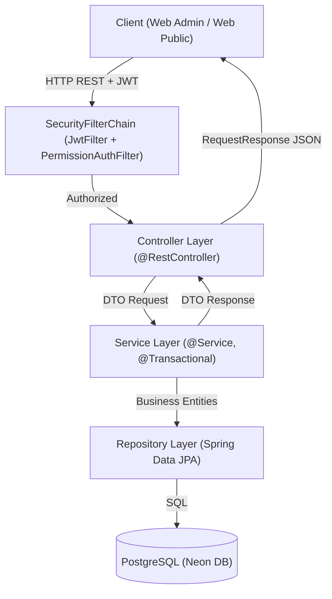

# Luồng Kiến Trúc Code Tổng Thể

## 1. Sơ đồ Mermaid luồng kiến trúc (Architecture Flow)

## 2. Các thành phần chính
* **Entry Points**: 
  * Lead Controller: [`LeadController`](file:///home/lenovo/Downloads/DATN/ecms_web_application/OC01/src/main/java/com/ecms_web_application/OC01/controller/LeadController.java)
  * Student Controller: [`StudentController`](file:///home/lenovo/Downloads/DATN/ecms_web_application/OC01/src/main/java/com/ecms_web_application/OC01/controller/StudentController.java)
* **Xử lý nghiệp vụ**:
  * Lead Service: [`LeadService`](file:///home/lenovo/Downloads/DATN/ecms_web_application/OC01/src/main/java/com/ecms_web_application/OC01/service/LeadService.java)
  * Student Service: [`StudentService`](file:///home/lenovo/Downloads/DATN/ecms_web_application/OC01/src/main/java/com/ecms_web_application/OC01/service/StudentService.java)

## 3. Ghi chú quy chuẩn bắt buộc
### Bất biến (Invariants)
* Mọi request ghi (POST/PUT/DELETE) vào Lead và Student đều phải chạy trong `@Transactional`.
* Các bản ghi log (`LeadStatusLog`, `LeadAssignmentLog`, `StudentStatusLog`) chỉ thêm (append-only), không cho phép sửa hoặc xóa.
* Mã học viên `student_code` không được phép chỉnh sửa sau khi đã cấp.

### Giả định (Assumptions)
* User đã được xác thực qua token JWT khi gọi các API quản trị nội bộ.
* Database PostgreSQL đã có sẵn cấu trúc bảng và các ràng buộc khóa ngoại (foreign keys).

### Tác dụng phụ (Side-effects)
* Ghi dữ liệu trực tiếp vào database PostgreSQL.
* Tự động sinh nhật ký thay đổi trạng thái hoặc chuyển phân công khi thực hiện tác vụ tương ứng.

### Luồng lỗi (Failure/Edge cases)
* Lỗi trùng lặp dữ liệu duy nhất (`student_code`, `lead_id`): Quăng `ErrorHandler(HttpStatus.CONFLICT)`.
* Không tìm thấy đối tượng (ID không tồn tại): Quăng `ErrorHandler(HttpStatus.NOT_FOUND)`.
* Dữ liệu request không hợp lệ: Bị chặn tại Bean Validation (`@Valid`) quăng `MethodArgumentNotValidException` (400 Bad Request).

