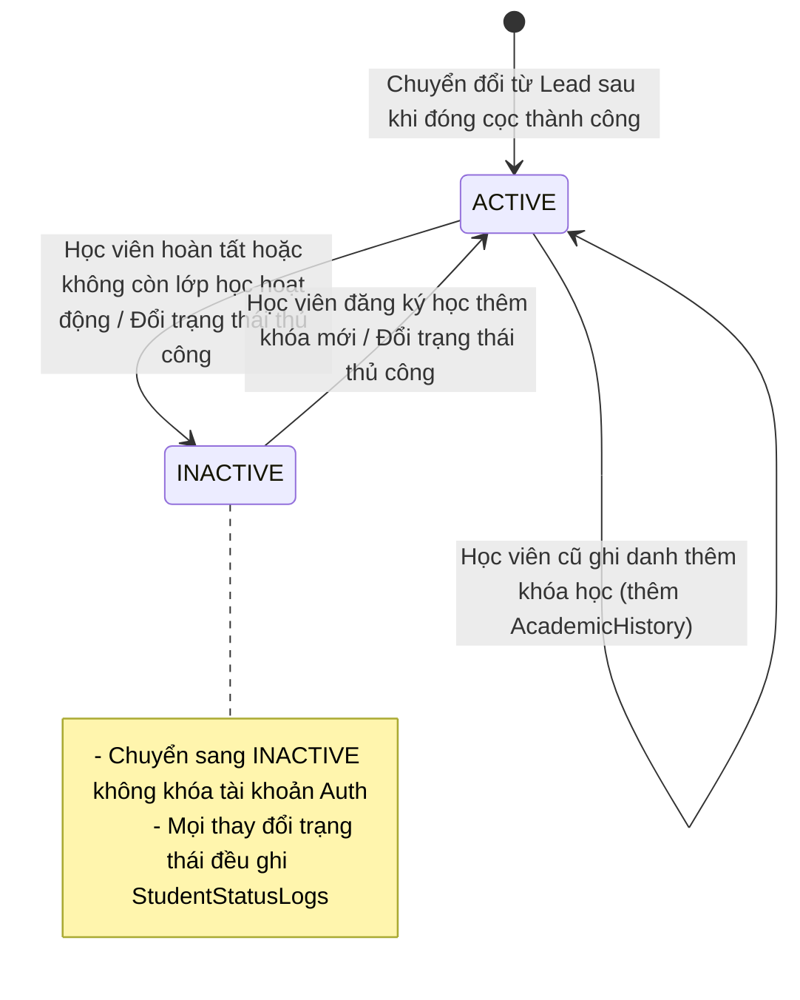

# Luồng Nghiệp Vụ Module Student

## 1. Sơ đồ Mermaid trạng thái và luồng học viên

## 2. Các hành động bắt buộc
1. **Chuyển đổi từ Lead (Chuyển đổi Idempotent)**:
   - Nhận `lead_id` cần chuyển đổi.
   - Kiểm tra `lead_id` đã tạo Student chưa. Nếu đã có thì trả về Student hiện tại (không tạo trùng).
   - Kiểm tra nếu là học viên cũ: liên kết `Lead`, thêm bản ghi vào `academic_histories`, kích hoạt lại trạng thái `ACTIVE` nếu đang `INACTIVE`.
   - Nếu là học viên mới:
     - Sinh mã học viên duy nhất theo mẫu: `STD` + `yyyyMM` + 4 chữ số ngẫu nhiên (VD: `STD2026105432`), retry tối đa 10 lần.
     - Tạo bản ghi trong bảng `students` (`status = ACTIVE`).
     - Cập nhật ngược lại bảng `leads`: `student_id = student.id`, `converted_at = now()`.
     - Thêm bản ghi vào `academic_histories` ban đầu nếu có `course_id`.
     - Ghi nhật ký vào `student_status_logs`.
2. **Quản lý người giám hộ (Guardians)**:
   - Thêm, sửa, xóa, lấy danh sách người giám hộ theo `student_id`.
3. **Lịch sử học tập (Academic History)**:
   - Xem và ghi nhận các lượt học theo từng khóa học của học viên.
4. **Cập nhật trạng thái**:
   - Khi chuyển trạng thái giữa `ACTIVE` và `INACTIVE`, bắt buộc ghi lý do vào `student_status_logs`.
5. **Giao diện quản trị & Trải nghiệm người dùng (UI/UX)**:
   - Thẻ thống kê KPI động (Tổng học viên, Đang học ACTIVE, Tạm ngưng INACTIVE) hỗ trợ tương tác lọc danh sách tức thì.
   - Bảng dữ liệu hiển thị mã học viên định dạng monospace bất biến, họ tên kèm Avatar, kênh nguồn (từ Lead hoặc trực tiếp).
   - Drawer chi tiết học viên bao gồm hồ sơ cá nhân, quản lý thêm/xóa người giám hộ với Popconfirm bảo vệ, lịch sử học tập và nhật ký thay đổi trạng thái kiểm toán.

## 3. Ghi chú quy chuẩn bắt buộc
### Bất biến (Invariants)
* Mã học viên `student_code` là duy nhất và tuyệt đối không được phép sửa đổi sau khi đã cấp.
* Mỗi `Lead` chỉ được gắn với duy nhất 1 `Student` (`uk_students_lead`).
* Trạng thái `INACTIVE` không được phép khóa tài khoản đăng nhập (Auth).
* Tất cả các thay đổi trạng thái đều phải ghi vào `student_status_logs` (chỉ thêm, không sửa/xóa).

### Giả định (Assumptions)
* Khách hàng đã được xác nhận thanh toán cọc thành công từ Tuition Module trước khi gọi chuyển đổi.
* Thông tin họ tên, email, số điện thoại được kế thừa trực tiếp từ Lead sang Student nếu không có chỉ định mới.

### Tác dụng phụ (Side-effects)
* Ghi dữ liệu vào `students`, `guardians`, `student_status_logs`, `academic_histories`.
* Cập nhật `student_id` và `converted_at` trên bảng `leads`.

### Luồng lỗi (Failure/Edge cases)
* Trùng mã học viên quá 10 lần: Ném `ErrorHandler(HttpStatus.INTERNAL_SERVER_ERROR)` cảnh báo quản trị.
* Cố tình sửa đổi `student_code` qua API cập nhật: Bị từ chối hoặc bỏ qua (không cho phép sửa).
* Chuyển đổi Lead không tồn tại: Báo lỗi `404 Not Found`.

